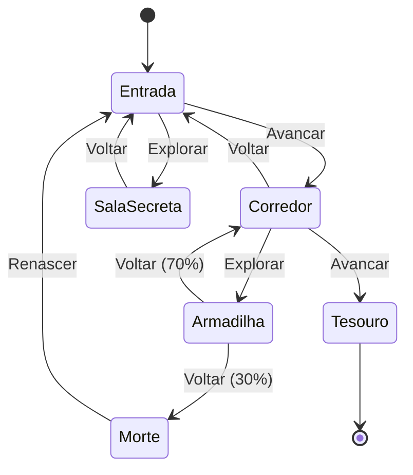

# Dungeon Zelda MBT

Protótipo em **Haskell** que une duas ideias sobre uma pequena dungeon inspirada em *Zelda*:

1. **Um jogo de texto** que você joga no terminal, com sorte, vidas e morte.
2. **Teste Baseado em Modelos (MBT)** com **Algoritmo Genético (AG)**: o computador descobre sozinho a menor sequência de ações que passa por todos os lugares e caminhos da dungeon.

Os dois usam **o mesmo modelo** da dungeon, então as regras ficam escritas em um lugar só.
---

## Sumário

- [O que é MBT, em uma frase](#o-que-é-mbt-em-uma-frase)
- [A dungeon](#a-dungeon)
- [Como executar](#como-executar)
- [O menu](#o-menu)
- [Jogando](#jogando)
- [Algoritmo Genético](#algoritmo-genético)
- [Estrutura do código](#estrutura-do-código)
- [Limitações e próximos passos](#limitações-e-próximos-passos)

---

## O que é MBT, em uma frase

Você descreve o que o sistema **pode** fazer (o *modelo*) e o computador gera testes a partir dessa descrição, medindo quanto do modelo cada teste exercita (a *cobertura*).

## A dungeon

**Estados (salas):** `Entrada`, `Corredor`, `SalaSecreta`, `Armadilha`, `Tesouro`, `Morte`

**Eventos (ações):** `Avancar`, `Explorar`, `Voltar`, `Renascer`

**Transições:**

| Origem        | Evento     | Destino        | Chance      |
|---------------|------------|----------------|-------------|
| `Entrada`     | `Avancar`  | `Corredor`     | sempre      |
| `Entrada`     | `Explorar` | `SalaSecreta`  | sempre      |
| `SalaSecreta` | `Voltar`   | `Entrada`      | sempre      |
| `Corredor`    | `Explorar` | `Armadilha`    | sempre      |
| `Corredor`    | `Avancar`  | `Tesouro`      | sempre      |
| `Corredor`    | `Voltar`   | `Entrada`      | sempre      |
| `Armadilha`   | `Voltar`   | `Corredor`     | **70%**     |
| `Armadilha`   | `Voltar`   | `Morte`        | **30%**     |
| `Morte`       | `Renascer` | `Entrada`      | sempre      |



O `Tesouro` é o único estado final: chegar nele encerra a partida. A `Morte` custa uma vida, e quando as 3 vidas acabam o jogo termina.

## Como executar

**Requisito:** [GHC](https://www.haskell.org/ghc/) (instale via [GHCup](https://www.haskell.org/ghcup/)). Só a biblioteca padrão é usada, sem dependências externas. Não usa `head`/`tail`, que geram aviso nas versões mais novas. A versão compacta foi escrita sem acesso a um compilador; se aparecer erro ao compilar, avise.

```bash
runghc main_final (8).hs
```

Ou compilando:

```bash
ghc main_final (8).hs
./main_final (8)       # no Windows: .\main_final (8).exe
```

O programa envia o texto em UTF-8. No **Windows (PowerShell)**, rode `chcp 65001` antes de abrir o `ghci` ou o executável; sem isso, `ç`, `ã` e `é` aparecem trocados por símbolos. O comando vale só para a janela aberta. Se ainda ficar estranho, troque a fonte do terminal para Consolas ou Cascadia Mono.

No `ghci`, depois de `ghci main_final.hs`, digite `main` para iniciar e `:q` para sair.

## O menu

```
=== Dungeon Zelda ===
  1) Jogar a dungeon
  2) Gerar testes com o Algoritmo Genético
  3) Reproduzir uma sequência de eventos
  0) Sair
```

As opções que usam sorte pedem uma **semente** (um número inteiro; Enter usa 42). A mesma semente produz sempre a mesma sorte, então qualquer partida pode ser repetida. Ctrl+D (fim da entrada) encerra o programa sem erro.

## Jogando

Exemplo de tela:

```
  [ SalaSecreta ]
         |
  [   Entrada   ] --- [ *Corredor*  ] --- [   Tesouro   ]
         |                   |
  [    Morte    ] --- [  Armadilha  ]

  Vidas: 3   Turnos: 1   (* = você está aqui)
  Opções: Explorar, Avancar, Voltar
```

A largura das salas é calculada pelo código, então as barras `|` ficam sempre alinhadas. Se você criar uma sala nova, acrescente-a na função `desenharMapa`.

**Comandos:**

| Comando | Atalho | O que faz |
|---|---|---|
| `avancar` | `a` | Avançar |
| `explorar` | `e` | Explorar |
| `voltar` | `v` | Voltar |
| `renascer` | `r` | Renascer (só depois de morrer) |
| `mapa` | `m` | Redesenha o mapa |
| `ajuda` | `?` | Lista os comandos |
| `sair` | `s` | Encerra a partida |

**Digitação flexível:** maiúsculas, acentos e espaços não importam (`  AVANÇAR ` funciona), abreviações são aceitas, e erros de digitação geram sugestão (`voltra` → "Você quis dizer: Voltar?"). Avisos de erro aparecem em destaque e **não** redesenham a tela.

Na Armadilha, a tela mostra as chances: `Voltar (70% Corredor / 30% Morte)`.

Ao fim de cada partida você vê um resumo com a sequência jogada e como repeti-la.

## Algoritmo Genético

**Ideia:** cada indivíduo é uma sequência de eventos (um teste). A nota mede quanto da dungeon ela cobre.

```
nota = 0,4 × cobertura de estados
     + 0,6 × cobertura de transições
     − 0,5 × quantidade de eventos
```

O desconto por tamanho faz o AG preferir testes **curtos**. Com ele, a nota máxima é 96 (100 menos 0,5 × 8 eventos).

**Como a Armadilha depende de sorte**, o teste acompanha *todos os lugares onde o jogador poderia estar* a cada passo. Um evento impossível em um lugar é simplesmente ignorado ali. Isso permite que um único teste cubra os dois desfechos da armadilha.

**Parâmetros:** população 40, 60 gerações, torneio de 3, mutação de 25%, no máximo 14 eventos por teste, com elitismo (o melhor sempre sobrevive).

**Exemplo de execução (semente 42):**

```
geração 0 : 49.3   [Avancar,Renascer,Explorar,Avancar,Voltar,Explorar,Avancar,Voltar]
geração 10: 95.0   [Avancar,Explorar,Voltar,Renascer,Voltar,Explorar,Renascer,Voltar,Avancar,Avancar]
geração 20: 95.5   [Avancar,Explorar,Voltar,Voltar,Explorar,Renascer,Voltar,Avancar,Avancar]

Cobertura de estados:    100.0%
Cobertura de transições: 100.0%
Nota final:              95.5
```

**Resultados medidos** (na versão de 709 linhas; a lógica do AG foi mantida, mas não foram refeitos na versão compacta):

- O menor teste que cobre tudo tem **8 eventos** (busca exaustiva: não existe nenhum com 7 ou menos, e há exatamente 3 com 8).
- Em 30 sementes (1 a 30), o AG chegou a **100% de cobertura em todas**. Em 12 delas achou a sequência mínima de 8 eventos (nota 96,0); nas outras 18 achou uma de 9 ou 10 eventos (nota 95,0 a 95,5).

A sequência encontrada pode ser colada na **opção 3** do menu para ser jogada de verdade.

## Estrutura do código

Tudo está em `main_final (8).hs` (200 linhas), em 7 partes:

| Cabeçalho | Parte | Conteúdo |
|---|---|---|
| 1 | Modelo | Estados, eventos e a lista de transições com pesos. |
| — | Sorte e jogo | Logo depois do modelo: sorteio reproduzível (`sorteio`), escolha por pesos (`escolher`), estado da partida e a função `passo`. Sem teclado nem tela. |
| 4 | Digitação | `interpretar` transforma o texto digitado em comando. |
| 5 | Mapa | Desenho com largura calculada. |
| 6 | Cobertura | Simulação de teste sobre o modelo e cálculo das porcentagens. |
| 7 | Algoritmo Genético | Nota, torneio, cruzamento, mutação e laço de gerações. |
| — | Teclado e tela | Fim do arquivo, a partir de `perguntar`. Único lugar com `putStrLn` e `getLine`. |

**Para mudar a dungeon**, edite a lista `modelo`. O jogo, a cobertura e o AG se adaptam. Se criar um estado novo, acrescente-o também em `desenharMapa`.

## Limitações e próximos passos

- [ ] Inventário (chaves, itens, inimigos): hoje o estado do jogador tem só posição, vidas e turnos.
- [ ] Mais salas e caminhos: o modelo é pequeno e o AG o resolve com facilidade.
- [ ] Sugestões de digitação: a comparação é simples e pode não sugerir quando falta uma letra no meio da palavra.
- [ ] Testes automatizados com HUnit/QuickCheck (o autoteste embutido foi removido na versão compacta).
- [ ] Mostrar de novo a trilha "onde o jogador pode estar a cada passo" na tela do AG (removida na versão compacta).
- [ ] Salvar em arquivo as sequências de teste geradas.
- [ ] Ajustar o AG para achar a sequência mínima em mais sementes (hoje são 12 de 30).

